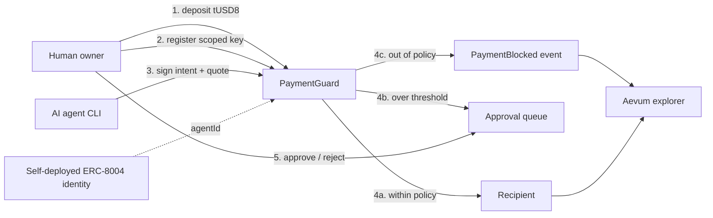

# Agentic Payment Guard

[中文版 README](./README.zh-CN.md)

**Scoped, auditable tUSD8 payments for autonomous AI agents on QDay Aevum testnet.**

Built for [Aevum Builder Challenge #1](https://dorahacks.io/hackathon/qday/detail). A human funds a vault and grants an AI agent a *session key* with a per-transaction cap, a daily cap, a recipient allowlist, an expiry and a human-approval threshold. The agent pays on-chain. Out-of-policy attempts are **blocked on-chain with an event** instead of silently failing, so every success and every rejection is verifiable on the explorer.

> QDay has not published official ERC-8004 registry addresses or ERC-4337 session-key addresses on Aevum yet. This project self-deploys reference implementations of those primitives. Nothing here depends on an unpublished address.

## How it works



### Payment ID

`paymentId = keccak256(abi.encode(sessionKey, nonces[sessionKey]++))`. It is bound to the key, unpredictable and replay-safe. The starter kit's `Checkout.sol` lets anyone pay any `orderId` with any amount and front-run the real buyer. This app structurally removes that bug: the ID cannot be claimed in advance, the amount must match a signed EIP-712 quote, and the recipient must be allowlisted.

## Features mapped to the judging criteria

| Criterion | What this repo provides |
|---|---|
| UX | Responsive Next.js dashboard, plain-language error decoder, network guard, tx status + explorer links |
| Verifiable demo | 7 scripted on-chain scenarios; blocked payments are successful transactions with decoded events |
| Documentation | Full zh/en docs with architecture, contract reference, env tables, addresses, reproduction steps |
| Innovation | Policy-as-contract agent payments; blocked-event audit trail; self-deployed ERC-8004 identity |
| Platform integration | Real tUSD8 (EIP-3009 / 2612), EIP-712, EIP-8004, 1,000-block chunked logs, Shanghai EVM, legacy tx |
| Real-world utility | Fits merchant/agent operations: caps, allowlist, expiry, approvals, instant revocation |
| Safety | Least privilege, spending caps, expiry, revocation, human approval, on-chain audit trail |
| Open source | MIT + NOTICE; reusable `@aevum-kit/aevum` ABIs, agent CLI and Foundry tests |

## Quickstart (local, no funds needed)

Requirements: Node 22+, pnpm, Foundry.

```bash
git clone --recursive <YOUR_REPO_URL>.git
cd agentic-payment-guard
make install
make build && make test          # 32 unit tests, no network needed
make anvil                       # terminal 1: empty local chain, Shanghai EVM
make deploy-all-local            # terminal 2: deploy guard + registries + MockUSD8
make dev                         # http://localhost:3000
```

A local fork with the **real** tUSD8:

```bash
make fork                        # 127.0.0.1:8555, chain 440050
make deploy-all-fork
make deal TO=<your wallet>       # 100 tUSD8 + 10 tQDAY, fork only
cp web/.env.example web/.env.local
# set NEXT_PUBLIC_*_FORK addresses from deploy output
cp agent/.env.example agent/.env
npm --prefix agent run setup
npm --prefix agent run demo
```

`make check` additionally runs fork tests against the live Aevum RPC. It needs a direct (non-proxied) connection to `https://rpc-test.qday.info`.

## Deploy to Aevum testnet

```bash
cast wallet import aevum-deployer --interactive
cast wallet address --account aevum-deployer
# fund from https://faucet.qday.info/en or Discord /faucet <address>
QUOTE_SIGNER=<address of a second test key> make deploy-all-aevum ACCOUNT=aevum-deployer
```

Copy the printed addresses into `web/.env.local` and `agent/.env`. See [docs/deployment.md](./docs/deployment.md) for the full variable table and the verifier workaround.

### One-click Vercel deployment

[](https://vercel.com/new/clone?repository-url=https%3A%2F%2Fgithub.com%2Fzerokkcoder%2Fagentic-payment-guard&root-directory=web&project-name=agentic-payment-guard&repository-name=agentic-payment-guard&env=NEXT_PUBLIC_NETWORKS,NEXT_PUBLIC_GUARD_AEVUM,NEXT_PUBLIC_IDENTITY_AEVUM,TRUSTED_IP_HEADER&envDefaults=%7B%22NEXT_PUBLIC_NETWORKS%22%3A%22aevum%22%2C%22TRUSTED_IP_HEADER%22%3A%22x-vercel-forwarded-for%22%7D&envDescription=Guard%20and%20registry%20addresses%20printed%20by%20make%20deploy-all-aevum&envLink=https%3A%2F%2Fgithub.com%2Fzerokkcoder%2Fagentic-payment-guard%23deploy-to-aevum-testnet)

Replace `zerokkcoder` with your GitHub username after creating the public repository. Keep the whole repo connected: Vercel needs `pnpm-lock.yaml` and the pnpm workspace at the root, with **Root Directory = `web`**.

## Agent CLI

```bash
npm --prefix agent run init       # chain, policy, vault, remaining daily spend
npm --prefix agent run setup      # deposit + register three scoped keys
npm --prefix agent run demo       # allowed | cap | notallowlisted | approval | dailycap | revoked | expired
npm --prefix agent run -- scenario allowed
npm --prefix agent run -- pay 1
```

Every scenario prints a `paymentId`, a tx hash and an explorer URL. See [docs/agent.md](./docs/agent.md).

## Known constraints

- Aevum RPC is HTTPS-only, no WebSocket. The UI polls over HTTP.
- `eth_getLogs` covers at most 1,000 blocks per call; `getLogsChunked` handles it.
- The explorer contract verifier is not working yet. README addresses + source commit link are the accepted proof.
- QDay's official ERC-8004 and session-key contracts are unpublished; ours are self-deployed reference implementations.
- The relayer's rate limits live in memory. Use a shared store before exposing it to real traffic.

## Documentation

- [Architecture 架构设计](./docs/architecture.md) · [中文](./docs/architecture.zh-CN.md)
- [Contracts 合约说明](./docs/contracts.md) · [中文](./docs/contracts.zh-CN.md)
- [Agent CLI](./docs/agent.md) · [中文](./docs/agent.zh-CN.md)
- [Demo script 演示脚本](./docs/demo.md) · [中文](./docs/demo.zh-CN.md)
- [Deployment 部署](./docs/deployment.md) · [中文](./docs/deployment.zh-CN.md)
- [Integration 平台集成](./docs/integration.md) · [中文](./docs/integration.zh-CN.md)

MIT licensed. Based on the official [Aevum Starter Kit](https://github.com/qday-io/aevum-starter-kit); see [NOTICE.md](./NOTICE.md).
