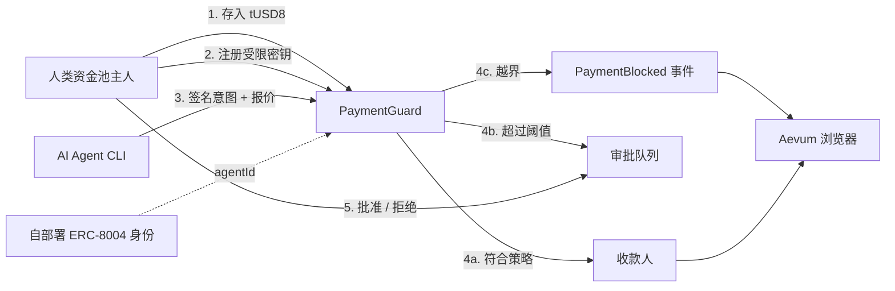

# Agentic Payment Guard（AI 受控支付守卫）

[English README](./README.md)

**面向自主 AI Agent 的、有边界且可审计的 tUSD8 支付应用，运行在 QDay Aevum 测试网。**

为 [Aevum Builder Challenge #1](https://dorahacks.io/hackathon/qday/detail) 开发。人类向资金池存入 tUSD8，并给 AI agent 注册一把带边界的 **session key**：单笔上限、每日上限、收款人白名单、到期时间、大额人工审批阈值。Agent 在链上付款；越界尝试不会静默失败，而是产生链上 `PaymentBlocked` 事件，因此成功与拦截都能在区块浏览器验证。

> QDay 官方尚未公布 Aevum 上的 ERC-8004 注册表地址或 ERC-4337 session key 地址。本项目自部署参考实现，不依赖任何未公布地址。

## 工作原理



支付 ID 为 `keccak256(abi.encode(sessionKey, nonces[sessionKey]++))`，与密钥绑定、不可预测、不可重放。官方 starter kit 的 `Checkout.sol` 允许任何人用任意金额支付任意 `orderId` 并抢先占位；本项目从结构上消除该问题：ID 无法提前抢占，金额必须匹配 EIP-712 签名报价，收款人必须在白名单内。

## 对应评审标准

| 标准 | 本项目交付 |
|---|---|
| 用户体验 | 响应式 Next.js 控制台、白话错误提示、网络检查、交易状态与浏览器链接 |
| 演示清晰可验证 | 7 个链上脚本场景；被拦截交易也是成功交易，事件可解码 |
| 文档完整 | 中英双语架构、合约说明、环境变量表、地址表、复现步骤 |
| 创新性 | 策略即合约的 Agent 支付、拦截事件审计轨迹、自部署 ERC-8004 身份 |
| 平台集成 | 真实 tUSD8（EIP-3009/2612）、EIP-712、ERC-8004、1000 区块分块日志、Shanghai EVM、legacy 交易 |
| 实用价值 | 适配商户与自动化 Agent：额度、白名单、到期、审批、即时撤销 |
| 安全与控制 | 最小权限、支出上限、会话过期、即时撤销、人工审批、链上审计 |
| 开源贡献 | MIT + NOTICE；可复用 ABI、Agent CLI 与 Foundry 测试 |

## 快速开始（本地，无需代币）

需要 Node 22+、pnpm、Foundry。

```bash
git clone --recursive https://github.com/zerokkcoder/agentic-payment-guard.git
cd agentic-payment-guard
make install
make build && make test          # 32 个单元测试，无需网络
make anvil                       # 终端 1：空本地链，Shanghai EVM
make deploy-all-local            # 终端 2：部署守卫、注册表和 MockUSD8
make dev                         # http://localhost:3000
```

使用**真实 tUSD8** 的本地 fork：

```bash
make fork                        # 127.0.0.1:8555，chain 440050
make deploy-all-fork
make deal TO=<你的钱包>          # 仅 fork 上：100 tUSD8 + 10 tQDAY
cp web/.env.example web/.env.local
# 把部署输出的地址填进 NEXT_PUBLIC_*_FORK
cp agent/.env.example agent/.env
npm --prefix agent run setup
npm --prefix agent run demo
```

`make check` 还会在真实 Aevum RPC 上跑 fork 测试。在 TLS 代理环境下先运行 `make rpc-proxy`，并传入 `AEVUM_RPC=http://127.0.0.1:8546`。见 [docs/deployment.zh-CN.md](./docs/deployment.zh-CN.md)。

## 部署到 Aevum 测试网

```bash
cast wallet import aevum-deployer --interactive
cast wallet address --account aevum-deployer
# 从 https://faucet.qday.info/en 或 Discord /faucet <地址> 领取测试币
QUOTE_SIGNER=<第二个测试私钥对应的地址> make deploy-all-aevum ACCOUNT=aevum-deployer
```

把输出地址填入 `web/.env.local` 和 `agent/.env`。完整环境变量表和浏览器验证器失效的应对见 [docs/deployment.zh-CN.md](./docs/deployment.zh-CN.md)。

### Vercel 一键部署

[](https://vercel.com/new/clone?repository-url=https%3A%2F%2Fgithub.com%2Fzerokkcoder%2Fagentic-payment-guard&root-directory=web&project-name=agentic-payment-guard&repository-name=agentic-payment-guard&env=NEXT_PUBLIC_NETWORKS,NEXT_PUBLIC_GUARD_AEVUM,NEXT_PUBLIC_IDENTITY_AEVUM,TRUSTED_IP_HEADER&envDefaults=%7B%22NEXT_PUBLIC_NETWORKS%22%3A%22aevum%22%2C%22TRUSTED_IP_HEADER%22%3A%22x-vercel-forwarded-for%22%7D)

按钮已指向本仓库。Vercel 必须连接整个仓库（Root Directory = `web`），因为应用通过 pnpm workspace 引用 `packages/aevum`。

## Agent CLI

```bash
npm --prefix agent run init       # 查看链、策略、vault、当日剩余额度
npm --prefix agent run setup      # 存款并注册三把受限密钥
npm --prefix agent run demo       # allowed | cap | notallowlisted | approval | dailycap | revoked | expired
npm --prefix agent run -- scenario allowed
npm --prefix agent run -- pay 1
```

每个场景都打印 `paymentId`、交易哈希和浏览器链接。详见 [docs/agent.zh-CN.md](./docs/agent.zh-CN.md)。

## 已知约束

- Aevum RPC 仅支持 HTTPS，没有 WebSocket；界面用 HTTP 轮询。
- `eth_getLogs` 单次最多 1000 个区块，`getLogsChunked` 已处理。
- 浏览器合约验证器暂不可用；用 README 中的地址 + 源码 commit 链接作为验证凭证。
- QDay 官方 ERC-8004 / session key 合约尚未发布；本项目为自部署参考实现。
- Relayer 限流仅存内存；面向真实流量前需换共享存储。

## 文档

- [架构设计](./docs/architecture.zh-CN.md) · [English](./docs/architecture.md)
- [合约说明](./docs/contracts.zh-CN.md) · [English](./docs/contracts.md)
- [Agent CLI](./docs/agent.zh-CN.md) · [English](./docs/agent.md)
- [演示脚本](./docs/demo.zh-CN.md) · [English](./docs/demo.md)
- [部署](./docs/deployment.zh-CN.md) · [English](./docs/deployment.md)
- [平台集成](./docs/integration.zh-CN.md) · [English](./docs/integration.md)

MIT 许可。基于官方 [Aevum Starter Kit](https://github.com/qday-io/aevum-starter-kit)，见 [NOTICE.md](./NOTICE.md)。
